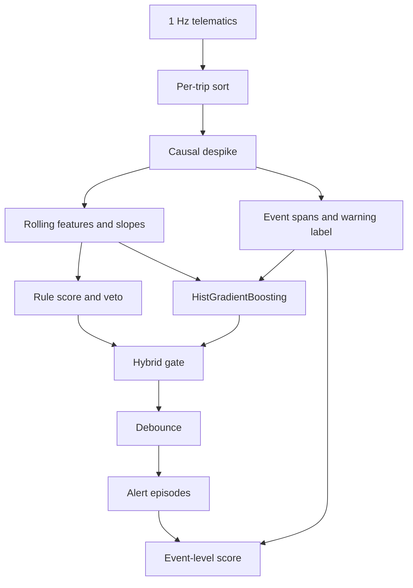

# Engine overheat alert architecture

`notebook.ipynb` is the testing bench for a 1-second telematics alerter. Each row is one second of one trip. The alerter warns before coolant stays hot long enough to count as an overheat, and it keeps the false-alarm rate down by requiring the model and a physics rule layer to agree.

## Flow

Trips are split into train, validation, and test. Seconds from the same trip stay in one split, so the test score is not inflated by adjacent seconds leaking across the cut.

## Data

Set `DATA_CSV` to a file with one row per second. Required columns:

| Column | Role |
| --- | --- |
| `trip_id` | Split unit and feature window |
| `coolant_temp_c` | Primary thermal signal |
| `engine_rpm` | Heat input |
| `engine_load_pct` | Heat input |
| `vehicle_speed_kmh` | Airflow through the radiator |

Used when present, filled with a neutral value when absent: `timestamp`, `vehicle_id`, `oil_temp_c`, `throttle_pct`, `intake_air_temp_c`, `ambient_temp_c`, `radiator_fan_on`, `ac_on`, `grade_pct`, `fuel_rate_lph`.

Leave `DATA_CSV` as `None` to run the built-in fleet. That fleet is a 1 Hz thermal simulation with normal driving, hot-but-stable days, cold starts, short hills, heat soaks that recover, sensor spikes, a drifting coolant sensor, and three overheat modes (traffic with weak cooling, fan failure, loaded climb). The physical temperature is stored as `coolant_true_c` and is used only to mark simulated events. It is not a model feature.

If a real file already marks seconds where the engine is overheating, set `LABEL_COLUMN` to that 0/1 column. The warning label is then the horizon before each marked run.

## Label

An event starts when repaired coolant stays at or above `COOLANT_EVENT_C` (108°C) for `SUSTAIN_S` seconds (15), or the repaired trace touches `EXTREME_C` (115°C). Repair for labeling is a 5-second median, so a one-second spike does not become an event.

`y_warn` is 1 for the `HORIZON_S` seconds before onset (180 seconds by default). Seconds inside the event are left blank and are dropped from training. The model learns the approach to the line. It is not trained to recognize an engine that is already over it.

## Features

All slopes and rolling windows are causal. They use the current second and earlier seconds only.

1. **Despike.** If coolant jumps by more than `SPIKE_C_PER_S` (5°C in one second), that sample is replaced with the last good value. The raw jump is kept as `sensor_spike`.
2. **Level and rate.** Clean coolant, 10/30/60-second means, and slopes in °C per second.
3. **Load context.** Load, speed, rpm, throttle, grade, and fan, each with a short rolling mean. `low_airflow_load` is high when load is high and speed is low.
4. **Thermal context.** Coolant minus ambient, oil minus coolant, seconds spent at or above 100°C in the last minute, and how long coolant has been both hot and rising (`rising_persist_s`).

## Three alerters

Validation picks the operating point with the lowest false alarms per hour among candidates that still reach `MIN_RECALL` (0.70). Lock any threshold by setting it in the settings cell. The last notebook cell can rescore the same test trips with a new threshold and no retrain (`USE_SANDBOX`).

### Rules

Each true condition adds one point to `rule_score`:

- Clean coolant at or above 99°C
- 10-second slope at or above 0.04°C/s
- 30-second slope at or above 0.025°C/s
- 30-second load at or above 60% and speed at or below 35 km/h
- Coolant at least 62°C above ambient while the 30-second slope is still positive
- Oil at or above 108°C while the 10-second coolant slope is positive
- Hot-and-rising condition already held for 12 seconds
- Fan on in slow traffic, with load still high and coolant still rising

A second is vetoed, and cannot alert, when any of these is true:

- The raw coolant step exceeds the spike limit
- Clean coolant is below 80°C (cold start)
- The 30-second slope is falling and coolant is still under 107°C
- Speed is high, load is low, slope is flat, and indicated coolant is already hot (cruise with a sensor offset)

The rule alerter fires when the score and the rising-persistence counter both clear their thresholds, coolant is in the approach band, and the veto is off.

### Model

`HistGradientBoostingClassifier` with balanced class weights. Inputs are `FEATURE_COLS` only. The label is `y_warn`. Output is `proba`, the chance that this second sits in the pre-event window.

The model alerter fires when `proba` is at or above `ml_tau`.

### Hybrid

The hybrid is the production decision. A veto always blocks the second. Otherwise the second is a candidate when either branch is true:

- **Strong:** probability at or above `tau_high`, coolant at or above 97°C, 30-second slope at or above 0.02°C/s, and rule score at least 2
- **Confirmed:** probability at or above `tau_mid`, rule score at least 4, rising persistence at least 12 seconds, and coolant at or above 96°C

## Debounce and scoring

A candidate second becomes an alert only after the condition is true for `DEBOUNCE_NEED` of the last `DEBOUNCE_WINDOW` seconds (5 of 8). Alert seconds within `EPISODE_GAP_S` (40) are one episode.

Event-level metrics on the test trips:

| Metric | Meaning |
| --- | --- |
| Recall | Share of events with an alert in the warning window or during the event |
| Early recall | Share alerted before coolant crosses the line |
| Precision | Share of alert episodes that sit on a real event |
| False alarms per hour | Episodes with no event nearby |
| Median lead | Seconds from the alert to event onset. Positive means the alert came first |

Second-level average precision on the validation warning label is printed as a ranking check. The operating decision uses the event table, because a false alarm is an episode, not a single second.

## Where to change behavior

| Goal | Edit in the settings cell |
| --- | --- |
| Use your own seconds | `DATA_CSV`, and `LABEL_COLUMN` if you have confirmed overheat seconds |
| Move the overheat line | `COOLANT_EVENT_C`, `SUSTAIN_S`, `EXTREME_C` |
| Warn earlier or later | `HORIZON_S` |
| Demand fewer missed events before cutting false alarms | `MIN_RECALL` |
| Make the rules stricter | `RULE_*`, `HYBRID_CONFIRM_SCORE`, `HYBRID_CONFIRM_PERSIST` |
| Ignore smaller sensor jumps, or catch smaller ones | `SPIKE_C_PER_S` |
| Stop flicker | `DEBOUNCE_NEED`, `DEBOUNCE_WINDOW` |
| Change model capacity | `MODEL_PARAMS` |
| Try a threshold without retraining | Last cell, `USE_SANDBOX = True` and `SANDBOX` |
